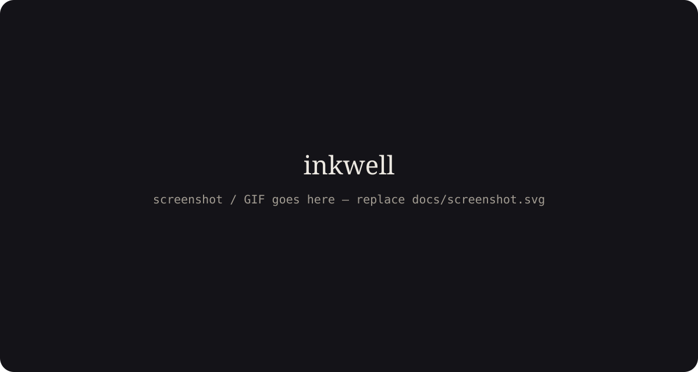

# inkwell

A writing arena and typing game. Write with live stats, build combos, earn XP, keep your streak, and play **Word Serpent**: a typing game where you steer a serpent by typing the words next to its head, and its body spells out everything you've typed.

No account, no backend. Everything is saved in your browser.



## Features

### Write
- Distraction-free editor set in Newsreader, with lines capped near 68 characters
- Live stats: words, characters (with and without spaces), sentences, paragraphs, reading time, average word length
- Live WPM and accuracy (accuracy = characters kept vs. deleted)
- Session timer and word goal with a progress ring
- Three modes:
  - **Free write**: no pressure, stats tracked
  - **Sprint**: countdown (1–15 min) with a word goal; ends automatically
  - **Focus**: everything fades while you type; the summary appears after 8 seconds of quiet (or press Esc)
- Autosaved pages, reopen them from **Saved pages** (delete has undo)
- Export as `.txt` or `.md`, or copy everything

### Word Serpent
- Type a word shown next to the serpent's head to move onto that tile; eat ink drops to grow
- A drift timer slides the serpent forward if you hesitate. Don't hit walls or your own body
- **Five skill tiers**: Hatchling (short lowercase words) → Viper → Cobra (capitals and punctuation) → Basilisk (long words) → Ouroboros (numbers and symbols)
- **Placement test**: 30 seconds of typing suggests your starting tier
- **Adaptive difficulty**: the drift timer adjusts gently (±25%) to your recent WPM
- **Gardens**: four hand-made boards per tier, 1–3 stars each (clear · 95% accuracy · tier WPM target), each unlocks the next
- **Endless** mode with a best score per tier, and a **daily garden** that's the same for everyone

### Game layer
- XP for every word and ink drop, multiplied by your combo; bonuses for goals, clears, stars, and challenges
- Levels with titles and a level-up celebration
- Daily streak flame
- Combo meter that drains in real time and resets if you pause
- Daily challenge picked from the date (e.g. "100 words in 2 minutes", "no backspace", "every sentence under 10 words")
- Trophy case with 13 badges (some secret)
- Session summary card built to be screenshotted (plus "copy summary")
- Optional synthesized sound effects (off by default)

### Polish
- Light ("paper") and dark ("ink") themes, following your system until you choose
- Keyboard-first (press `?` or `⌘/Ctrl+K` for the list)
- Accessible: visible focus states, labelled controls, polite toast announcements, `prefers-reduced-motion` respected
- Responsive from 375 px phones to wide desktops

## Keyboard shortcuts

| Action | Keys |
| --- | --- |
| New page | `Alt+N` |
| Writing / Word Serpent | `Alt+W` / `Alt+G` |
| Sprint / Focus mode | `Alt+S` / `Alt+F` |
| Toggle theme / sound | `Alt+T` / `Alt+M` |
| Saved pages / Trophy case | `Alt+H` / `Alt+B` |
| Shortcuts | `⌘/Ctrl+K` or `?` |
| Finish session / pause serpent | `Esc` |

`Alt` is `⌥ Option` on macOS. Shortcuts use `Alt` rather than `⌘⇧` because browsers reserve combos like `⌘⇧N` (incognito window).

## Getting started

Requires Node 20+.

```bash
npm install
npm run dev        # http://localhost:5173
npm run build      # production build in dist/
npm run preview    # serve the build locally
```

## Deploying

The build uses a relative base path, so `dist/` works at any URL.

- **GitHub Pages**: push to `main`. The included workflow (`.github/workflows/deploy.yml`) builds and deploys. Enable it once under *Settings → Pages → Source: GitHub Actions*.
- **Vercel**: import the repo; `vercel.json` sets everything.
- **Netlify**: import the repo; `netlify.toml` sets everything.

## Project structure

```
src/
  app/              App shell, shortcut list
  components/
    chrome/         Top bar, saved pages drawer, shortcuts modal
    editor/         Writing view, export menu
    stats/          Live stats rail and tiles
    game/           XP bar, streak, combo meter, badges, trophy case, summary card, level-up burst
    serpent/        Word Serpent: board, run screen, hub, placement test
    ui/             Primitives (Button and CircularProgress from 21st.dev; Dialog, Tooltip, Segmented)
  game/             Pure game logic (no React)
    achievements/   One file per badge + registry.ts
    challenges/     One file per daily challenge + registry.ts
    serpent/        Engine, tiers, word pools, garden layouts
    xp.ts combo.ts streak.ts progression.ts events.ts
  hooks/            useSerpent, useHotkeys, useNow, useTheme
  lib/              Text stats, export, sound, dates, seeded RNG
  store/            Zustand store persisted to localStorage
```

### Add a badge

Create `src/game/achievements/myBadge.ts`:

```ts
import { Rocket } from 'lucide-react'
import type { Achievement } from './types'

export default {
  id: 'words-in-a-day',
  title: 'Prolific',
  description: 'Write 2,000 words in one session.',
  icon: Rocket,
  check: ({ summary }) => summary.words >= 2000,
} satisfies Achievement
```

Then add it to the list in `achievements/registry.ts`. `check` receives the updated profile and the session that just ended.

### Add a daily challenge

Create a file in `src/game/challenges/` that exports a `Challenge` (`setup` tells the app how to start it, `validate` decides success), then add it to `challenges/registry.ts`.

### Add a garden or words

- New board layout: add an 11×9 grid to `LAYOUTS` in `game/serpent/gardens.ts` (`#` = wall, `S` = start). Every tier gets it.
- More words: edit the pools in `game/serpent/words.ts`.

## Data and privacy

All data lives in `localStorage` under the key `inkwell:v1`. Nothing is sent anywhere. Clearing site data resets your progress.

## Tech stack

- [React 19](https://react.dev) + [TypeScript](https://www.typescriptlang.org) + [Vite](https://vite.dev)
- [Tailwind CSS v4](https://tailwindcss.com)
- [Zustand](https://zustand.docs.pmnd.rs) (state and persistence)
- [Motion](https://motion.dev) (animation)
- [Radix UI](https://www.radix-ui.com) primitives, [Sonner](https://sonner.emilkowal.ski) toasts, [Lucide](https://lucide.dev) icons
- Components from [21st.dev](https://21st.dev): `@originui/button`, `@shadcnui-blocks/progress-10`
- Fonts: Newsreader, Geist, Geist Mono (Google Fonts)

## License

[MIT](LICENSE)
